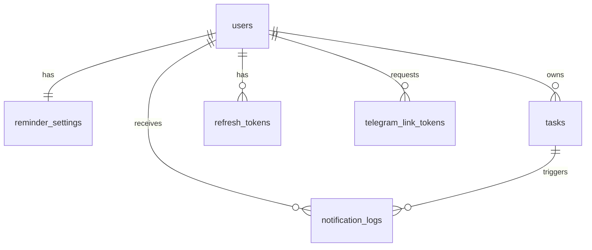

# StudentTask – Design

Status: **DRAFT, menunggu persetujuan**. Belum ada kode. Tanggal: 2026-11-20.

## 1. Tujuan dan alasan

Mahasiswa kesulitan mengatur waktu dan tugas kuliah yang tersebar di banyak mata kuliah. StudentTask adalah web app personal task management khusus tugas kuliah: mahasiswa membuat akun sendiri, mencatat tugas dengan deadline dan prioritas, memantau status, melihatnya di dashboard dan kalender, dan menerima pengingat otomatis lewat Telegram sebelum deadline.

Pemakai: mahasiswa umum (banyak akun, bukan hanya satu orang). Satu jenis user saja.

### Goals
1. Mahasiswa register, login, dan mengelola tugas miliknya sendiri (CRUD, filter, sort, pagination).
2. Dashboard dan kalender (bulan/minggu/hari) yang membaca data langsung dari backend.
3. Reminder Telegram otomatis (H-1 hari, H-6 jam, H-1 jam, saat deadline), bisa diatur per jenis, **tanpa duplikat** dan **tanpa kirim untuk task selesai**.
4. Data antar mahasiswa terisolasi penuh.
5. Jalan dengan `docker compose up`.

### Non-goals (tidak dibuat di MVP)
- Admin, dosen, multi-role.
- Verifikasi email dan **lupa/reset password** (butuh email; ditunda). Struktur disiapkan: `users.email_verified_at`.
- Notifikasi selain Telegram (email, WhatsApp, push), tugas berulang, lampiran file, berbagi tugas, aplikasi mobile native, i18n multi-bahasa.
- Message queue (hanya disiapkan jalurnya).

### Anti-goals (dianggap gagal walau fitur "jalan")
- Reminder terkirim dua kali, atau terkirim untuk task yang sudah selesai/dihapus.
- Satu mahasiswa bisa membaca atau mengubah data mahasiswa lain.
- Bot token, JWT secret, atau token linking muncul di frontend, log, atau git.
- Halaman memakai data palsu, bukan backend sungguhan.

## 2. Batasan
- Stack tetap: Next.js + TypeScript + Tailwind + shadcn/ui + Lucide + React Hook Form + Zod; Java 21 + Spring Boot 3.x + Spring Security + Spring Data JPA + Maven; MySQL 8; Telegram Bot API; Docker Compose. Frontend dan backend dua aplikasi terpisah. Constructor injection.
- Zona waktu default Asia/Jakarta.
- Entity JPA tidak boleh keluar lewat REST; pakai DTO.
- Identitas user selalu dari security context, tidak dari request.
- Repo target `/Users/admin/workspace/ind/task-reminder` kosong dan belum git repo (greenfield). Aturan platform ai-workspace: tidak commit/push/PR tanpa konfirmasi, tidak commit secret, tidak pakai data nyata.

## 3. Pendekatan yang dipertimbangkan

Keputusan utama: cara kerja reminder engine.

| | A. Jadwal disimpan di tabel | **B. Jadwal dihitung saat scheduler jalan (dipilih)** | C. Message queue |
|---|---|---|---|
| Inti | Tiap perubahan task menulis/membatalkan baris jadwal | Scheduler mencari task di jendela waktu reminder lalu "mengklaim" lewat insert dengan unique key | Event ke Redis/RabbitMQ, worker mengirim |
| Deadline diubah/selesai/dihapus | Harus dihitung ulang di banyak titik, rawan terlewat | Otomatis benar (membaca keadaan terkini) | Harus membatalkan job |
| Duplikat | Unique key | Unique key | Perlu pengaman tambahan |
| Biaya | +1 tabel, banyak kode sinkronisasi | Paling sedikit kode | +1 service, berlebihan untuk MVP |

Dipilih **B**: paling sedikit titik kegagalan; aturan "selesai/dihapus/diubah" terpenuhi karena scheduler selalu membaca keadaan sekarang. Bagian "kirim" dipisah di balik antarmuka `ReminderDispatcher` agar nanti bisa diganti queue.

## 4. Functional Requirements Analysis

### A. Auth
- Register: `fullName`, `email`, `password`, `confirmPassword`. Email dinormalisasi lowercase, unik. Password 8–72 karakter (batas BCrypt 72 byte), minimal 1 huruf dan 1 angka. Register membuat `users` + `reminder_settings` (semua true) dalam satu transaksi.
- Login email+password → access token JWT (15 menit) di body, refresh token di cookie httpOnly. Pesan error login generik (tidak membedakan email salah/password salah).
- Refresh: token dirotasi (satu kali pakai). Pemakaian ulang token lama → semua refresh token user dicabut. Logout mencabut refresh token. Ganti password mencabut semua refresh token.
- Frontend: halaman terproteksi; saat load, panggil refresh untuk memulihkan sesi.

### B. Dashboard
Angka: Total, Pending (= TODO), In Progress, Completed, Overdue, Upcoming (7 hari). Catatan: Overdue adalah irisan dari TODO/IN_PROGRESS, bukan status terpisah. Komponen: dueSoon (5 deadline terdekat belum selesai), topPriority (5 prioritas tertinggi belum selesai), daftar 7 hari ke depan, progress (% completed), ringkasan per status.

### C. Task
Field: title (wajib, ≤200), description (≤5000), subject (≤100), deadline (wajib, tanggal+waktu), priority (LOW/MEDIUM/HIGH/URGENT), status (TODO/IN_PROGRESS/COMPLETED).
- Status bisa berpindah bebas. COMPLETED mengisi `completed_at`; keluar dari COMPLETED mengosongkannya (reminder otomatis berlaku lagi bila deadline masih ke depan).
- Deadline di masa lalu **boleh** saat membuat (mencatat tugas terlambat); tidak ada reminder untuknya.
- Task milik user lain → 404 (bukan 403, agar keberadaan id tidak bocor).
- List: `q` (judul, contains), `subject`, `status`, `priority`, `deadlineFrom`, `deadlineTo`, `sort` (`deadline|priority|createdAt|completedAt`), `dir`, `page` (mulai 0), `size` (default 10, maks 50). Halaman Completed = `status=COMPLETED&sort=completedAt&dir=desc`.
- Tambahan kecil di luar daftar endpoint spec: `GET /api/tasks/subjects` (daftar mata kuliah unik milik user untuk dropdown filter).

### D. Kategori deadline (dihitung backend, tidak disimpan)
Dihitung pada waktu aktual dan zona waktu user, urutan prioritas:
1. **OVERDUE**: deadline < sekarang dan belum COMPLETED.
2. **DUE_TODAY**: tanggal lokal deadline = tanggal lokal hari ini.
3. **DUE_TOMORROW**: tanggal lokal deadline = besok.
4. **UPCOMING**: setelah besok sampai sekarang + 7 hari.
5. **LATER**: lebih dari itu.
Task COMPLETED tidak mendapat kategori (null).

### E. Telegram dan reminder: lihat bagian 8 dan 9.

### F. Calendar
`GET /api/calendar/tasks?from&to` mengembalikan task ringkas dalam rentang (maks 62 hari) untuk ketiga tampilan; frontend mengganti rentang saat navigasi. Warna per prioritas. Klik tugas membuka drawer detail.

### G. Profile dan Settings
Edit nama; edit email dan ganti password (**wajib `currentPassword`**); timezone (daftar IANA); connect/disconnect/test Telegram; toggle 4 jenis reminder.

### Bahasa antarmuka (keputusan saya, silakan koreksi)
Label navigasi tetap seperti spec (Dashboard, My Tasks, Calendar, Completed, Settings); teks isi dan pesan Telegram berbahasa Indonesia. Tanpa framework i18n.

## 5. Arsitektur

```
Browser ──HTTPS──> Next.js (frontend, :3000)
                     │  rewrite /api/* → backend (same-origin, cookie aman)
                     ▼
              Spring Boot (backend, :8080) ──JDBC──> MySQL 8
                │   ▲                         
   scheduler ───┘   └── Telegram webhook (prod) / getUpdates (dev)
        │
        └──HTTPS──> api.telegram.org (sendMessage)
```

Monorepo:
```
task-reminder/
├── backend/            # Maven, Java 21
├── frontend/           # Next.js
├── docs/               # design, ERD, API, roadmap, deployment
├── docker-compose.yml
├── .env.example        # nama variabel saja, tanpa nilai rahasia
└── README.md
```

Backend `com.studenttask`: `config, security, common, auth, user, task, notification, telegram, calendar, scheduler` (tiap modul: `controller, service, repository, dto, entity` bila relevan). Aturan dependensi: controller → service → repository; modul lain hanya lewat service. Spec melarang entity bocor ke REST: mapper manual atau MapStruct (builder memilih).

Lintas modul:
- Respons seragam: `{ "success": true, "data": …, "meta": { page,size,totalElements,totalPages } }` atau `{ "success": false, "error": { "code", "message", "details":[{field,message}] } }`. Satu `@RestControllerAdvice`.
- Migrasi: **Flyway** (`V1__init.sql`…), `spring.jpa.hibernate.ddl-auto=validate`.
- Waktu: JVM dan JDBC UTC; kolom `DATETIME(3)` UTC; JSON ISO-8601; konversi zona hanya di batas (kategori deadline, tampilan, pesan Telegram).
- Konfigurasi: semua rahasia via environment variable (`JWT_SECRET`, `TELEGRAM_BOT_TOKEN`, `TELEGRAM_WEBHOOK_SECRET`, `TELEGRAM_BOT_USERNAME`, kredensial DB, `CORS_ALLOWED_ORIGINS`). Aplikasi gagal start bila rahasia wajib kosong.
- Rate limiting: Bucket4j in-memory per IP untuk register/login/refresh, per user untuk `/api/telegram/test` dan `/api/telegram/connect`. Batasan: tidak dibagi antar instance (diterima untuk MVP, dicatat di risiko).
- Header keamanan dan CSP di frontend; CORS hanya origin yang dikonfigurasi.
- Log: JSON/terstruktur dengan request id; tidak mencatat password, token, isi pesan, judul tugas; chat id dimasker.

Frontend: App Router; folder per fitur; React Hook Form + Zod; `fetch` wrapper tunggal yang menyisipkan access token (di memori, bukan localStorage), refresh otomatis saat 401 lalu ulang sekali. Middleware Next hanya mengalihkan berdasarkan keberadaan cookie refresh; otorisasi sebenarnya di backend. Loading skeleton, empty state, error state, toast, dialog konfirmasi hapus. Sidebar di desktop, drawer/bottom navigation di ponsel.

Docker Compose: `mysql` (healthcheck, volume), `backend` (menunggu mysql sehat; image multi-stage, user non-root), `frontend`. Konfigurasi dari `.env` (tidak di-commit).

## 6. ERD



## 7. Skema database (MySQL 8, engine InnoDB, utf8mb4)

```sql
CREATE TABLE users (
  id                    BIGINT AUTO_INCREMENT PRIMARY KEY,
  full_name             VARCHAR(100)  NOT NULL,
  email                 VARCHAR(254)  NOT NULL,
  password_hash         VARCHAR(100)  NOT NULL,          -- BCrypt
  email_verified_at     DATETIME(3)   NULL,              -- disiapkan untuk verifikasi email (belum dipakai)
  telegram_chat_id      BIGINT        NULL,
  telegram_connected_at DATETIME(3)   NULL,
  timezone              VARCHAR(64)   NOT NULL DEFAULT 'Asia/Jakarta',
  created_at            DATETIME(3)   NOT NULL,
  updated_at            DATETIME(3)   NOT NULL,
  UNIQUE KEY uk_users_email (email),
  UNIQUE KEY uk_users_telegram_chat (telegram_chat_id)   -- satu chat hanya untuk satu akun
);

CREATE TABLE tasks (
  id            BIGINT AUTO_INCREMENT PRIMARY KEY,
  user_id       BIGINT       NOT NULL,
  title         VARCHAR(200) NOT NULL,
  description   TEXT         NULL,
  subject       VARCHAR(100) NULL,
  deadline      DATETIME(3)  NOT NULL,                  -- UTC
  priority      VARCHAR(10)  NOT NULL,                  -- LOW|MEDIUM|HIGH|URGENT
  priority_rank TINYINT AS (CASE priority WHEN 'LOW' THEN 1 WHEN 'MEDIUM' THEN 2
                            WHEN 'HIGH' THEN 3 ELSE 4 END) STORED,   -- untuk sort prioritas
  status        VARCHAR(12)  NOT NULL DEFAULT 'TODO',   -- TODO|IN_PROGRESS|COMPLETED
  completed_at  DATETIME(3)  NULL,
  version       BIGINT       NOT NULL DEFAULT 0,        -- optimistic locking
  created_at    DATETIME(3)  NOT NULL,
  updated_at    DATETIME(3)  NOT NULL,
  CONSTRAINT fk_tasks_user FOREIGN KEY (user_id) REFERENCES users(id) ON DELETE CASCADE,
  CONSTRAINT ck_tasks_priority CHECK (priority IN ('LOW','MEDIUM','HIGH','URGENT')),
  CONSTRAINT ck_tasks_status   CHECK (status IN ('TODO','IN_PROGRESS','COMPLETED')),
  KEY ix_tasks_user_status_deadline (user_id, status, deadline),
  KEY ix_tasks_user_deadline        (user_id, deadline),
  KEY ix_tasks_user_priority        (user_id, priority_rank, deadline),
  KEY ix_tasks_user_subject         (user_id, subject),
  KEY ix_tasks_status_deadline      (status, deadline)   -- query scheduler
);

CREATE TABLE reminder_settings (
  id                   BIGINT AUTO_INCREMENT PRIMARY KEY,
  user_id              BIGINT      NOT NULL,
  reminder_24_hours    BOOLEAN     NOT NULL DEFAULT TRUE,
  reminder_6_hours     BOOLEAN     NOT NULL DEFAULT TRUE,
  reminder_1_hour      BOOLEAN     NOT NULL DEFAULT TRUE,
  reminder_at_deadline BOOLEAN     NOT NULL DEFAULT TRUE,
  created_at           DATETIME(3) NOT NULL,
  updated_at           DATETIME(3) NOT NULL,
  UNIQUE KEY uk_reminder_settings_user (user_id),
  CONSTRAINT fk_reminder_settings_user FOREIGN KEY (user_id) REFERENCES users(id) ON DELETE CASCADE
);

CREATE TABLE notification_logs (
  id            BIGINT AUTO_INCREMENT PRIMARY KEY,
  user_id       BIGINT       NOT NULL,
  task_id       BIGINT       NOT NULL,
  reminder_type VARCHAR(16)  NOT NULL,   -- H24|H6|H1|AT_DEADLINE
  scheduled_at  DATETIME(3)  NOT NULL,   -- deadline dikurangi offset, UTC
  status        VARCHAR(12)  NOT NULL,   -- SENDING|SENT|RETRY|FAILED|SKIPPED
  attempts      INT          NOT NULL DEFAULT 0,
  next_retry_at DATETIME(3)  NULL,
  locked_at     DATETIME(3)  NULL,
  sent_at       DATETIME(3)  NULL,
  error_message VARCHAR(500) NULL,       -- sudah disanitasi, tanpa token/URL bot
  created_at    DATETIME(3)  NOT NULL,
  updated_at    DATETIME(3)  NOT NULL,
  CONSTRAINT fk_nlogs_user FOREIGN KEY (user_id) REFERENCES users(id) ON DELETE CASCADE,
  CONSTRAINT fk_nlogs_task FOREIGN KEY (task_id) REFERENCES tasks(id) ON DELETE CASCADE,
  UNIQUE KEY uk_nlogs_task_type_sched (task_id, reminder_type, scheduled_at),  -- pencegah duplikat
  KEY ix_nlogs_retry (status, next_retry_at),
  KEY ix_nlogs_stale (status, locked_at)
);

CREATE TABLE telegram_link_tokens (
  id         BIGINT AUTO_INCREMENT PRIMARY KEY,
  user_id    BIGINT      NOT NULL,
  token_hash CHAR(64)    NOT NULL,       -- SHA-256 hex; token asli tidak disimpan
  expires_at DATETIME(3) NOT NULL,
  used_at    DATETIME(3) NULL,
  created_at DATETIME(3) NOT NULL,
  UNIQUE KEY uk_tlt_hash (token_hash),
  KEY ix_tlt_user (user_id),
  CONSTRAINT fk_tlt_user FOREIGN KEY (user_id) REFERENCES users(id) ON DELETE CASCADE
);

CREATE TABLE refresh_tokens (               -- tambahan di luar spec: agar logout/rotasi nyata
  id          BIGINT AUTO_INCREMENT PRIMARY KEY,
  user_id     BIGINT      NOT NULL,
  token_hash  CHAR(64)    NOT NULL,
  expires_at  DATETIME(3) NOT NULL,         -- 7 hari
  revoked_at  DATETIME(3) NULL,
  created_at  DATETIME(3) NOT NULL,
  UNIQUE KEY uk_rt_hash (token_hash),
  KEY ix_rt_user (user_id),
  CONSTRAINT fk_rt_user FOREIGN KEY (user_id) REFERENCES users(id) ON DELETE CASCADE
);
```

Catatan desain:
- `notification_logs` memakai `ON DELETE CASCADE` ke task: log task yang dihapus tidak punya nilai. (Keputusan saya.)
- Pencarian judul memakai `LIKE '%q%'` dibatasi `user_id`; cukup untuk data per user yang kecil. FULLTEXT tidak perlu di MVP.
- Tabel lama bersih: token kedaluwarsa dan log lama dibersihkan oleh job harian (retensi log: 90 hari, bisa dikonfigurasi).

## 8. API (semua di bawah `/api`, JWT `Authorization: Bearer` kecuali ditandai publik)

| Method | Path | Isi | Respons |
|---|---|---|---|
| POST | `/auth/register` (publik) | `fullName,email,password,confirmPassword` | 201 profil |
| POST | `/auth/login` (publik) | `email,password` | 200 `{accessToken,expiresIn}` + cookie refresh |
| POST | `/auth/refresh` (cookie) | – | 200 token baru + cookie baru |
| POST | `/auth/logout` | – | 204, cookie dihapus, token dicabut |
| GET | `/auth/me` | – | profil singkat |
| GET | `/tasks` | filter (bagian 4C) | 200 halaman `TaskResponse[]` + `meta` |
| POST | `/tasks` | `title,description?,subject?,deadline,priority,status?` | 201 |
| GET | `/tasks/{id}` | – | 200 / 404 |
| PUT | `/tasks/{id}` | seperti POST (penuh) | 200 |
| PATCH | `/tasks/{id}/status` | `{status}` | 200 |
| DELETE | `/tasks/{id}` | – | 204 |
| GET | `/tasks/subjects` | – | `string[]` |
| GET | `/dashboard/summary` | – | counts, progress, `dueSoon[5]`, `topPriority[5]` |
| GET | `/dashboard/upcoming` | – | task 7 hari ke depan (maks 50) |
| GET | `/dashboard/overdue` | – | task terlambat (maks 50) |
| GET | `/calendar/tasks` | `from,to` (ISO, rentang ≤ 62 hari) | task ringkas |
| POST | `/telegram/connect` | – | `{deepLink,expiresAt}` |
| POST | `/telegram/webhook` (publik, header rahasia) | update Telegram | 200 |
| DELETE | `/telegram/disconnect` | – | 204 |
| POST | `/telegram/test` | – | 200 / 409 jika belum terhubung / 502 jika Telegram gagal |
| GET | `/reminders/settings` | – | 4 boolean |
| PUT | `/reminders/settings` | 4 boolean | 200 |
| GET | `/profile` | – | nama, email, timezone, `telegram:{connected,connectedAt}` |
| PUT | `/profile` | `fullName?,email?,timezone?,currentPassword?,newPassword?` | 200; email/password baru wajib `currentPassword` |

Aturan umum:
- `deadline` di request: ISO-8601 dengan offset (mis. `2026-11-21T23:59:00+07:00`); frontend menggabungkan date picker + time picker memakai zona user. Response selalu UTC (`…Z`) plus `deadlineCategory` untuk task belum selesai.
- Kode error: `VALIDATION_ERROR` 400, `UNAUTHENTICATED` 401, `FORBIDDEN` 403, `NOT_FOUND` 404, `CONFLICT` 409 (email dipakai, versi task bentrok), `RATE_LIMITED` 429, `TELEGRAM_UNAVAILABLE` 502.
- Setiap query repository memuat `user_id` dari security context. Tidak ada `userId` di request mana pun.
- Spesifikasi lengkap (skema field, contoh) ditulis menjadi `API_SPECIFICATION.md` di Phase 1.

## 9. Alur integrasi Telegram

1. User menekan **Connect Telegram** → `POST /telegram/connect`. Backend membatalkan token aktif sebelumnya, membuat token acak 32 byte (base64url, 43 karakter, muat di batas 64 karakter parameter `start`), menyimpan **hash**-nya, masa berlaku 10 menit, sekali pakai.
2. Backend mengembalikan `https://t.me/<BOT_USERNAME>?start=<token>`. Frontend menampilkan tombol/QR dan hitung mundur, lalu memeriksa `GET /profile` tiap 3 detik sampai `telegram.connected=true` atau token kedaluwarsa.
3. User membuka bot dan menekan Start → Telegram mengirim update `/start <token>`.
4. Update masuk lewat **webhook** (produksi): header `X-Telegram-Bot-Api-Secret-Token` dibandingkan dengan `TELEGRAM_WEBHOOK_SECRET` (constant-time); salah → 401. Atau lewat **long polling** `getUpdates` (development, `telegram.mode=polling`; hanya satu instance). Handler update-nya sama. Webhook menjawab 200 segera dan memproses update di pool terbatas (4 thread, antrean 100; penuh = dibuang); batas 5 perintah/menit per chat id dicek sebelum akses database atau balasan.
5. Handler hanya memproses chat `private` dan pesan teks `/start <token>`. Dalam satu transaksi: cari hash token yang belum dipakai dan belum kedaluwarsa → tandai `used_at` → set `users.telegram_chat_id` dan `telegram_connected_at`. Bila `chat_id` sudah terhubung ke akun lain (unique key) → tolak dan balas pesan penjelasan.
6. Bot membalas konfirmasi ("Akun a***@domain berhasil terhubung ... Bukan kamu? Kirim /stop"; email tersamar, tidak pernah lengkap) atau pesan gagal ("Token tidak valid/kedaluwarsa, buat ulang dari aplikasi"). `/start` tanpa token membalas petunjuk. `/stop` di chat private memutus akun yang terhubung ke chat itu.
7. Disconnect mengosongkan `chat_id` dan `connected_at`. Test notification mengirim pesan contoh ke chat user (rate limit 3/menit).

Aturan: bot token hanya di environment backend; user tidak pernah memasukkan token. Setelah webhook terpasang (`setWebhook` dengan `secret_token`), tidak boleh ada polling bersamaan; mode dipilih lewat konfigurasi.

## 10. Desain penjadwalan reminder (pendekatan B)

**Jenis dan offset:** `H24` = 24 jam, `H6` = 6 jam, `H1` = 1 jam, `AT_DEADLINE` = 0. `scheduled_at = deadline − offset`.

**Tiap tick** (default setiap 60 detik, `reminder.poll-interval`; `@Scheduled` dengan `fixedDelay`):
1. **Cari kandidat** per jenis, satu query terindeks:
   task `status <> 'COMPLETED'`, pemilik punya `telegram_chat_id` dan toggle jenis itu true, `scheduled_at <= now` dan `scheduled_at > now − catch-up window` (default 10 menit), dan belum ada baris `notification_logs` dengan `(task, jenis, scheduled_at)` yang sama. Batas per tick (default 200) agar tidak membanjiri Telegram.
2. **Klaim**: `INSERT` baris `notification_logs` dengan status `SENDING`, `attempts=1`, `locked_at=now`. Bila melanggar unique key (instance lain lebih dulu) → lewati. Transaksi pendek, selesai sebelum mengirim.
3. **Kirim di luar transaksi**: baca ulang task dan user (task bisa berubah sejak query). Bila task COMPLETED/hilang atau Telegram sudah tidak terhubung → status `SKIPPED`. Selain itu panggil `sendMessage` (plain text, tanpa `parse_mode`, agar judul tugas tidak bisa menyuntikkan markup).
4. **Catat hasil** dengan update atomik: sukses → `SENT`, `sent_at`; gagal sementara (timeout, 5xx, 429) → `RETRY` dengan `next_retry_at` = backoff 1, 5, 15 menit (hormati `retry_after` dari 429); gagal permanen (400, 403 bot diblokir) atau percobaan ke-4 habis → `FAILED`. `error_message` disanitasi (tanpa token atau URL bot).
5. **Retry dan baris macet**: tiap tick juga mengambil baris `RETRY` dengan `next_retry_at <= now`, dan baris `SENDING` dengan `locked_at` lebih lama dari 5 menit (proses mati di tengah). Pengambilan dengan `UPDATE … SET status='SENDING', locked_at=now, attempts=attempts+1 WHERE id=? AND status IN (…)`; hanya instance dengan `affected rows = 1` yang mengirim. Retry juga memeriksa ulang syarat langkah 3 dan jendela waktu: bila `now` sudah melewati deadline + catch-up window → `SKIPPED`.

**Konsekuensi (sengaja):**
- Deadline diubah → `scheduled_at` berubah → kunci baru → reminder dihitung ulang otomatis; reminder lama yang belum terkirim tidak pernah terjadi karena tidak ada baris yang menunggu.
- Task selesai/dihapus → tidak lagi lolos query; baris retry menjadi `SKIPPED`.
- Task dibuat dekat deadline → reminder yang waktunya sudah lewat dari catch-up window dilewati, bukan dikirim terlambat. Server mati singkat → reminder tertinggal masih terkirim bila dalam window.
- Jaminan: **tepat sekali di kondisi normal, paling sedikit sekali bila proses mati setelah Telegram menerima pesan tetapi sebelum status `SENT` tersimpan**. Kemungkinan sangat kecil, didokumentasikan, diterima di MVP.
- Isi pesan mengikuti contoh di spec, waktu dan tanggal dalam zona waktu user ("WIB" untuk Asia/Jakarta, kode zona lain sesuai user).
- Jalur ke queue: `ReminderScheduler` (cari+klaim) dan `ReminderDispatcher` (kirim+catat) dipisah; queue cukup menggantikan panggilan antar keduanya.

## 11. Pengujian

Backend (JUnit 5 + Mockito untuk unit; **Testcontainers MySQL 8** untuk repository dan klaim konkuren, karena aturan proyek meminta engine nyata): auth (register, login, rotasi dan reuse refresh token), CRUD task, kepemilikan task (user B → 404), filter prioritas/status/subject/tanggal, perhitungan kategori deadline (batas tengah malam, zona waktu, hari Selasa vs Rabu), pemilihan reminder (jendela, toggle, completed, telegram belum terhubung), **pencegahan duplikat dengan beberapa thread/instance mengklaim bersamaan**, linking Telegram (token valid/kedaluwarsa/dipakai ulang/chat milik akun lain/secret webhook salah), kegagalan Telegram (429, 5xx, 403, timeout) memakai klien Telegram yang di-stub. Telegram nyata tidak dipanggil di test. Target cakupan ≥80% baris pada kode berubah, ≥90% pada logika reminder, otorisasi, dan kategori deadline.

Frontend (Vitest + React Testing Library; Playwright untuk uji asap tata letak di lebar ponsel dan desktop; builder boleh mengganti alat bila ada alasan): validasi login/register, buat dan ubah task, filter, ubah status, tata letak responsif.

## 12. Roadmap

Tiap fase: bisa dijalankan dan diuji sebelum lanjut; dokumen diperbarui bila arsitektur/API berubah.

| Fase | Isi | Selesai bila |
|---|---|---|
| 1 Fondasi | Inisialisasi repo (git, branch `main`), skeleton backend + frontend, MySQL, Docker Compose, Flyway V1, pecah dokumen ini menjadi 8 file deliverable | `docker compose up` menjalankan 3 service, backend sehat, migrasi sukses, halaman kosong terbuka |
| 2 Auth | Register, login, refresh, logout, Spring Security, rate limit, alur auth frontend | User baru bisa daftar, login, tetap login setelah reload, logout mencabut sesi; tes auth hijau |
| 3 Task | CRUD, filter, sort, pagination, halaman List/Create/Edit/Detail/Completed | Semua filter bekerja; user B tidak bisa akses task user A (tes) |
| 4 Dashboard | Summary, upcoming, overdue, kategori deadline | Angka dashboard cocok dengan data uji |
| 5 Telegram | Bot, linking, webhook + polling, disconnect, test | Akun terhubung ke bot sungguhan lewat flow penuh; test message sampai |
| 6 Reminder | Scheduler, pengaturan, log, retry, duplikat | Tes konkuren tanpa duplikat; reminder nyata diterima sesuai jadwal |
| 7 Calendar | Bulan/minggu/hari | Navigasi dan klik tugas bekerja dengan data backend |
| 8 Hardening | Tes integrasi dan keamanan, perbaikan bug, konfigurasi produksi, panduan deploy | 12 kriteria penerimaan terpenuhi |

Alur git (mengikuti aturan platform): branch `feature/<slug>` per fase, Conventional Commits, tidak ada commit ke `main` langsung; push/PR hanya setelah konfirmasi Anda.

## 13. Risiko dan mitigasi

| # | Risiko | Mitigasi |
|---|---|---|
| 1 | Notifikasi ganda saat >1 instance | Unique key `(task, jenis, scheduled_at)` + klaim insert + update atomik; tes konkuren pada MySQL nyata |
| 2 | Proses mati setelah kirim, sebelum catat | Baris `SENDING` macet diambil ulang (at-least-once); risiko duplikat sangat kecil, didokumentasikan |
| 3 | Batas Telegram (≈30 pesan/detik global, 1/detik per chat) | Batas per tick, jeda antar kirim, hormati `retry_after` |
| 4 | Zona waktu/DST salah | Simpan UTC, `java.time.ZoneId`, tes batas tengah malam dan beberapa zona |
| 5 | Webhook butuh HTTPS publik | Mode polling untuk development; webhook untuk produksi, dipilih lewat konfigurasi |
| 6 | Pencurian token (XSS/CSRF) | Access token di memori, refresh httpOnly + SameSite=Strict + same-origin proxy, rotasi + deteksi reuse, CSP, cek Origin |
| 7 | Rate limit in-memory tidak dibagi antar instance | Diterima untuk 1 instance MVP; pindah ke penyimpanan bersama bila scale-out |
| 8 | Query scheduler melambat saat data besar | Query dibatasi jendela waktu dan terindeks; `EXPLAIN` di Phase 6; job pembersihan log |
| 9 | Bot diblokir user (403) | Tandai `FAILED`, tidak retry; UI Settings menampilkan peringatan bila pengiriman terakhir gagal (builder menentukan bentuknya) |
| 10 | Ganti email tanpa verifikasi | Wajib `currentPassword`; `email_verified_at` disiapkan; risiko dicatat |
| 11 | Judul tugas menyuntikkan markup ke pesan | Kirim plain text tanpa `parse_mode` |
| 12 | Tanpa lupa-password, akun terkunci bila password lupa | Non-goal MVP, ditulis di README; fitur setelah ada email |
| 13 | Lingkup membengkak (10 halaman, 3 tampilan kalender) | Fase dengan kriteria selesai; kalender memakai library bila menghemat usaha |
| 14 | Tebak `currentPassword` lewat sesi yang dicuri; flood webhook | 5 gagal/15 menit per user -> 429; ganti email mencabut refresh token; webhook asinkron terbatas + batas per chat; secret webhook `[A-Za-z0-9_-]{32,256}`; `api-base` wajib https |

## 14. Keputusan saya (bukan dari spec, silakan koreksi)

Flyway; Testcontainers; tabel `refresh_tokens`; kolom `priority_rank` dan `version`; endpoint `GET /tasks/subjects`; token di memori + cookie refresh httpOnly lewat proxy same-origin; mode Telegram polling/webhook; deadline lampau boleh saat membuat; catch-up window 10 menit; backoff 1/5/15 menit maksimum 4 percobaan; plain text untuk pesan; bahasa antarmuka Indonesia dengan label nav seperti spec; `currentPassword` untuk ganti email/password; 404 untuk task orang lain; tanpa lupa password.

## 15. Lampiran (hasil pemeriksaan builder)

### 15.1 Delapan dokumen deliverable (dibuat di Phase 1 dari dokumen ini)
`PROJECT_PLAN.md`, `SYSTEM_ARCHITECTURE.md`, `DATABASE_DESIGN.md`, `ERD.md`, `API_SPECIFICATION.md`, `DEVELOPMENT_ROADMAP.md`, `DEPLOYMENT_GUIDE.md`, `README.md`. Singkat, padat, diperbarui setiap arsitektur atau API berubah.

### 15.2 Dua belas kriteria penerimaan MVP (kriteria selesai Phase 8)
1. Mahasiswa dapat register dan login.
2. Mahasiswa dapat membuat, mengedit, dan menghapus tugas.
3. Mahasiswa dapat mengatur deadline dan prioritas.
4. Mahasiswa dapat melihat daftar tugas berdasarkan status.
5. Mahasiswa dapat melihat dashboard statistik.
6. Mahasiswa dapat melihat tugas melalui kalender.
7. Mahasiswa dapat menghubungkan Telegram.
8. Sistem mengirim reminder otomatis.
9. Sistem tidak mengirim notifikasi duplikat.
10. Task COMPLETED tidak menerima reminder berikutnya.
11. User tidak dapat mengakses data mahasiswa lain.
12. Aplikasi berjalan dengan Docker Compose.

### 15.3 Template pesan reminder (dari spec; plain text)
```
🔔 STUDENT TASK REMINDER

Halo, kamu memiliki tugas yang akan segera deadline!

📚 Mata Kuliah: {subject atau "-"}
📝 Tugas: {title}
⚡ Prioritas: {priority}
📅 Deadline: {tanggal, mis. 21 November 2026}
🕐 Waktu: {HH:mm} {WIB|WITA|WIT|kode zona}

Segera selesaikan tugasmu sebelum deadline!
```
Judul tugas boleh muncul di pesan Telegram (itu tujuannya), tetapi tidak boleh masuk log aplikasi.

### 15.4 Zona waktu
Zona waktu user (kolom `users.timezone`, default Asia/Jakarta) dipakai untuk: kategori deadline, batas hari di kalender, pesan Telegram, dan date/time picker di frontend. Frontend memakai zona dari profil, **bukan** zona browser.

### 15.5 Perilaku reminder saat task diubah
- Deadline diubah → kunci `(task, jenis, scheduled_at)` baru → reminder dihitung ulang sesuai spec. Konsekuensi yang diterima: bila pengingat jenis yang sama sudah terkirim untuk deadline lama, ia boleh terkirim lagi untuk deadline baru (itu jadwal baru, bukan duplikat jadwal yang sama).
- COMPLETED → TODO/IN_PROGRESS: hanya reminder yang `scheduled_at`-nya masih dalam catch-up window yang terkirim; yang lebih lama dilewati.
- Task dibuat dengan deadline dekat: reminder yang `scheduled_at`-nya sudah lewat dari window dilewati; sisanya terkirim tepat waktu.

### 15.6 Halaman dan rute frontend
`/login`, `/register`, `/dashboard`, `/tasks` (daftar + filter), `/tasks/new`, `/tasks/[id]` (detail), `/tasks/[id]/edit`, `/calendar` (detail tugas lewat drawer), `/completed`, `/settings` (profil, password, timezone, Telegram, reminder). Selain `/login` dan `/register` semuanya terproteksi.

## 16. Diserahkan ke builder
Pilihan library kalender, mapper DTO, struktur komponen dan token desain UI, detail Zod/RHF, format persis log dan metrik, tampilan peringatan bot diblokir, versi tepat dependensi (ikuti versi stabil yang kompatibel Java 21 dan Spring Boot 3.x), nilai default konfigurasi di atas boleh disetel bila ada alasan teknis.
